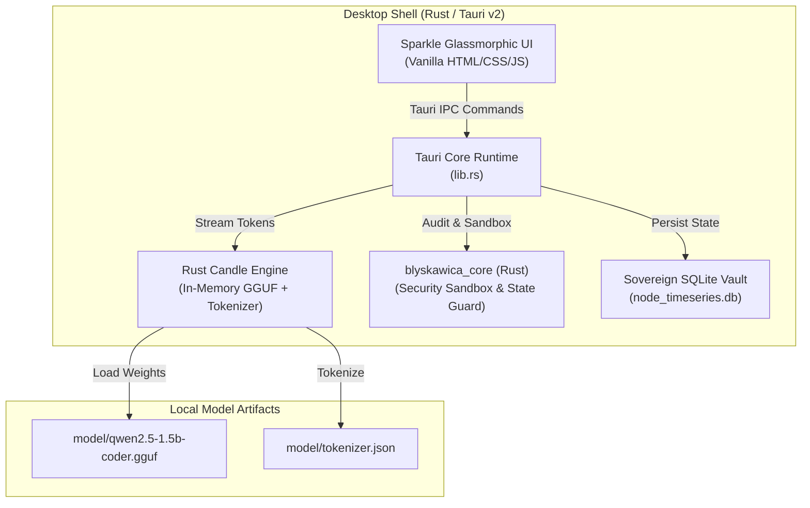

# Phase V10 — SPARKLE Desktop Shell (Full Standalone Offline AI)

## Status: Historyczny raport fazy V10

> Aktualny stan gotowości produktu, granica Rust/Python oraz kryteria offline/online są prowadzone w [kontrakcie samodzielnego runtime SPARKLE](../../technical/SPARKLE_RUNTIME_CONTRACT.md) i [zaakceptowanym planie rozwoju](../../planning/2026-10-development-plan.md).

This document records the V10 target architecture and implementation milestone. It is not current release evidence: the active plan retains open P0/P1 work for IPC review, reproducible quality gates, portability, consented online connectors, and data governance.

---

## Executive Summary

The V10 milestone established the following intended capabilities:
- **Native In-Memory SLM Inference**: Executes Small Language Models (e.g. Qwen 2.5 Coder 1.5B GGUF) directly inside the Rust Tauri core via the `candle` ML framework.
- **Rust-first inference path**: Intended to remove required runtime dependencies on Ollama, cloud endpoints, or external Python servers for conversational inference.
- **Rust Native Security & Sandboxing**: `blyskawica_core` provides hardware-level thread gating, rate throttling, and state management.
- **Local persistence direction**: Memory and time-series data are stored locally; encryption and retention claims remain subject to PRIV-01 validation.
- **Premium Glassmorphic Shell**: High-performance, reactive desktop user interface (`sparkle_app/src/`).

---

## Architecture



---

## Key Components

### 1. Tauri v2 Application Shell (`sparkle_app/`)
**Source**: [`sparkle_app/src-tauri/`](file:///c:/Projekty/Blyskawica/sparkle_app/src-tauri)

- **Entry Point**: `lib.rs` / `main.rs` — initializes window management, system tray, IPC handlers, and error boundaries.
- **Tauri IPC**: High-throughput asynchronous message bus connecting the frontend UI to backend Rust services.

### 2. Rust Candle Language Engine
- Directly streams tokens in real-time with sub-millisecond dispatch overhead.
- Supports quantized GGUF weights for minimal RAM footprint (~1.2 GB VRAM / RAM).

### 3. Native Security Core (`blyskawica_core/`)
**Source**: [`blyskawica_core/`](file:///c:/Projekty/Blyskawica/blyskawica_core)

- Enforces execution quotas, memory sandboxing, and quarantine boundaries before any system call or file I/O is allowed.

### 4. Setup & Launch Instructions

1. **Place Model Files**:
   ```bash
   mkdir -p model
   # Place Qwen 2.5 Coder GGUF and tokenizer:
   # model/qwen2.5-1.5b-coder.gguf
   # model/tokenizer.json
   ```

2. **Launch SPARKLE**:
   ```cmd
   Uruchom_Sparkle.bat
   ```
   or launch `sparkle_app.exe` directly from the release bundle.

---

## Historical Verification Claims

The following claims describe the phase report, not the current release state. Current verification is governed by the runtime contract and remediation plan:

- Offline behavior still requires no-network and no-hidden-sidecar deployment tests.
- Performance requires benchmark evidence on supported hardware.
- Release packaging requires native installation tests on Windows 11, Linux, and macOS.

---

## Related Documentation
- [Phase 9: Hyper-Synthesis Assimilation](../phase9_hyper_synthesis/README.md)
- [System Architecture](../../../ARCHITECTURE.md)
- [ADR 0001: Single Shell Decision](../../../docs/adr/0001-single-shell-decision.md)
