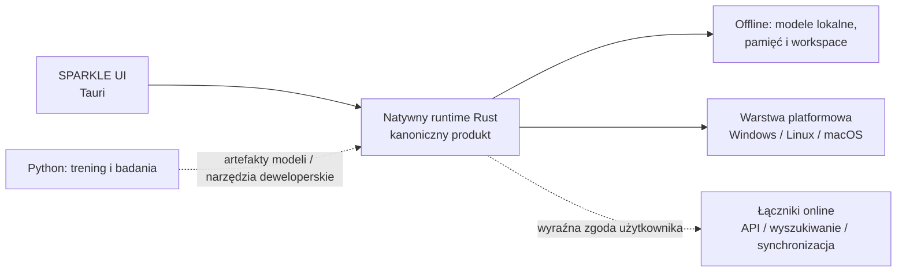

# Plan rozwoju i remediacji Błyskawicy / SPARKLE

> **Status:** zaakceptowany i aktywny — 2026-10-20  
> **Właściciel:** zespół projektu Błyskawica  
> **Źródło prawdy dla prac bieżących:** ten dokument. Historyczne roadmapy opisują zamiar lub stan w chwili ich powstania, a nie bieżący werdykt jakościowy.

> **Decyzja:** kierunek „SPARKLE jako samodzielny runtime Rust, Python jako toolchain” został zaakceptowany 2026-10-20. Zmiany planu i statusu jego modułów muszą pozostawać widoczne z [portalu dokumentacji](../README.md).

## 1. Werdykt wejściowy

Projekt ma wartościową, szeroką bazę funkcji: rdzeń Rust, powłokę Tauri, moduły Python/FastAPI, testy i obszerną dokumentację. Nie jest jednak gotowy do deklarowania pełnej gotowości produkcyjnej ani pełnej pracy offline. Najpierw trzeba domknąć granice zaufania, odtwarzalność oraz spójność dokumentacji, a dopiero potem rozszerzać V11.

**Docelowy produkt:** Błyskawica ma działać jako natywna aplikacja desktopowa SPARKLE, instalowana i uruchamiana bez wymaganego serwera Python, z pełnowartościowym trybem offline i opcjonalnymi, jawnymi usługami online. Obsługiwane platformy docelowe to Windows 11, Linux i macOS. Migracja rozpoczyna się od Windows 11, ponieważ obecna implementacja ma zależności Windows-specyficzne; architektura oraz CI muszą od początku pozostać przenośne.

Potwierdzone podczas audytu i bieżących prac:

- test gotowości samodzielnej powłoki: **9/9 zaliczonych**;
- testy rdzenia Rust: **53/53 zaliczone** w kontrolowanym katalogu tymczasowym workspace;
- testy runtime Tauri: **7/7 zaliczone**;
- testy bezpieczeństwa frontendu: **8/8 zaliczone**;
- linter Ruff: czysto (**0 problemów** bez auto-fix);
- `cargo fmt --check`: 100% czyste formatowanie dla obu skrzynek Rust (`blyskawica_core` oraz `sparkle_app/src-tauri`);
- skrypt kontroli artefaktów runtime: czysto (brak wycieków tożsamości i pamięci do indeksu Git);
- CI obejmuje rdzeń Rust na Windows/Linux/macOS oraz testy runtime Tauri na Windows.

### Ryzyko, które wymaga korekty opisów

Dokumenty mówią o „100% offline”, „production ready” i szyfrowanej SQLite. Implementacja nadal może uruchamiać sidecar Pythona, zawiera ścieżki wyszukiwania internetowego, a część danych SQLite jest przechowywana jako zwykły JSON/BLOB. Te deklaracje nie powinny być używane marketingowo ani bezpieczeństwowo przed ich potwierdzeniem testami wdrożeniowymi.

## 2. Docelowa architektura produktu

- **Rust + Tauri jest granicą produktu.** Uruchomienie, uprawnienia, pliki, pamięć lokalna, inference, konfiguracja i łączniki są dostarczane przez aplikację SPARKLE.
- **Offline jest trybem podstawowym.** Aplikacja uruchamia się, otwiera workspace i wykonuje lokalne funkcje bez sieci, FastAPI ani interpretera Python.
- **Online jest funkcją opcjonalną.** Każdy łącznik ma widoczny stan, zakres danych i zgodę użytkownika; brak sieci nie degraduje rdzenia do stanu błędu.
- **Python pozostaje narzędziem rozwojowym.** Zachowujemy go dla treningu, eksperymentów PyTorch i konwersji modeli, ale nie jako obowiązkowy element instalacji użytkownika końcowego.
- **Przenośność ma własną warstwę.** Funkcje specyficzne dla Windows (DPAPI, Job Object, WinAPI) otrzymują interfejs Rust z implementacjami dla Keychain na macOS i Secret Service/libsecret na Linuxie lub bezpiecznym fallbackiem, zanim staną się częścią kontraktu produktu.

## 3. Zasady prowadzenia prac

1. **Najpierw bezpieczeństwo i prywatność.** Żaden nowy moduł V11 nie omija poziomów uprawnień, granic workspace ani jawnej zgody użytkownika.
2. **Domyślna odmowa.** Dostęp do profilu użytkownika, sekretów, Internetu i systemu operacyjnego wymaga minimalnego niezbędnego poziomu oraz widocznego uzasadnienia w interfejsie.
3. **Prawda mierzalna.** Status „gotowe” wymaga komendy w CI, testu regresji i aktualnej dokumentacji; deklaracje historyczne muszą być oznaczone jako historyczne.
4. **Dane lokalne pod kontrolą.** W repozytorium nie przechowujemy sekretów, zrzutów tożsamości, baz użytkownika ani cache wrażliwych danych.
5. **Migracja małymi pionowymi wycinkami.** Każdy migrowany przepływ najpierw ma kontrakt, testy i implementację Rust, potem usuwa zależność aplikacji od endpointu Python.
6. **Żadnego ukrytego dostępu do sieci.** Kod online przechodzi przez jeden rejestr łączników, z trybem offline jako domyślnym.
7. **Portal dokumentacji jest kontraktem projektu.** Każdy aktywny moduł ma aktualny status, właściciela i odsyłacz z `docs/README.md`; nieaktualne deklaracje są oznaczane jako historyczne.
8. **Ciągłość kognitywna przed migracją.** Pythonowe zachowanie neuroregulacji, C.R.A. i PINN jest punktem odniesienia, a nie materiałem do mechanicznego przepisania. Nowy kod Rust może zastąpić dany przepływ dopiero po zgodności z syntetycznym kontraktem, pracy równoległej i świadomej decyzji o zmianie domyślnej ścieżki.

## 4. Kolejność prac

| Priorytet | Inicjatywa | Zakres i kryterium ukończenia |
|---|---|---|
| P0 | RNT-01: Kontrakt samodzielnego runtime | Spis funkcji wymaganych w desktopowej ścieżce użytkownika, granice Rust/Python i stabilne kontrakty komend Tauri. Wynik: SPARKLE ma formalnie zdefiniowany minimalny tryb offline bez sidecara. **Zakończono 2026-10-20:** kontrakt, bezpieczny opt-in sidecara, build release oraz smoke test startu bez sidecara. |
| P0 | SEC-01: Granice Tauri IPC | Każda komenda plikowa wymusza granicę workspace; narzędzia MCP nie działają na L1; sejf i skan katalogu profilu wymagają L3; testy regresji ścieżek. **Zakończono 2026-10-22:** statycznie przejrzano wszystkie zarejestrowane komendy IPC; telemetryka, sejf i katalogi modeli wymagają L3, a operacje workspace i MCP wymagają L2. Resolver odrzuca ścieżki bezwzględne i traversal, bezpiecznie obsługuje nowe pliki zagnieżdżone, a test regresji utrwala ten przypadek. Po dopuszczeniu Codex przez kontrolę aplikacji uruchomiono lokalnie `cargo test --lib`: rdzeń 34/34 i runtime Tauri 7/7. |
| P0 | SEC-02: Dane śledzone przez Git | Inwentaryzacja plików tożsamości/cache/secrets, bezpieczne usunięcie z indeksu po decyzji właściciela, rotacja każdego prawdziwego sekretu oraz reguły pre-commit/CI. **Zakończono 2026-10-26:** potwierdzono w kodzie (`agentic_honeypot.py`), że `decoy_workspace/dev_secrets.json` to wyłącznie syntetyczny honeypot o losowych poświadczeniach i fikcyjnej domenie. Brak realnych poświadczeń, brak konieczności rotacji i przepisywania historii Git. CI (`scripts/check_tracked_runtime_artifacts.py`) blokuje ponowne śledzenie artefaktów runtime i sekretów. |
| P0 | REL-01: Powtarzalny quality gate | Naprawa formatowania Rust i błędów Ruff; CI uruchamia Rust fmt/test, frontendowe sprawdzenie składni, testy Python i audyt zależności z przypiętymi/lockowanymi zależnościami. Dodaje macierz Windows 11/Linux/macOS dla Rust/Tauri. **Wdrożenie ukończono lokalnie 2026-10-22:** Ruff jest zielony bez auto-fix; 7 celowanych testów Python, składnia wszystkich modułów JavaScript i 8 testów bezpieczeństwa frontendu zaliczone; `cargo fmt --check` oraz testy rdzenia 34/34 i Tauri 7/7 są zielone. Sformatowano cały `blyskawica_core`. CI sprawdza teraz formatowanie core oraz testuje rdzeń i Tauri na Windows 11, Linuxie i macOS. Pierwszy zewnętrzny przebieg tej rozszerzonej macierzy pozostaje wymaganym dowodem wydaniowym. |
| P1 | RNT-02: Migracja krytycznej ścieżki do Rust | W kolejnych małych wycinkach przenieść z FastAPI do Tauri/Rust: stan aplikacji, workspace, lokalne inference, pamięć i orkiestrację łączników. Każdy wycinek kończy się testem działania bez Pythona. **Zakończono 2026-10-24 (PR #23, PR #24):** Wycinek 1 (pełny 10-buforowy stan neurochemiczny, adenozyna i homeostaza zgodna z kontraktem referencyjnym), Wycinek 2 (graceful fallback w przestrzeni ukrytej z ONNX i HNSW), Wycinek 3 (anulowanie generowania <50ms w Tauri IPC i UI). Dodatkowo zintegrowano koherencję kwantową mikrotubul i tłumienie szumów fononowych (Orch-OR eNeuro 2024), natywną Duszę (Soul z 25 Prawami Nethical i sejfem DPAPI/BLY1) oraz cyber-immunologię (Agentic Honeypot + Memory Ledger z detekcją dryfu wektorów). Testy rdzenia wzrosły do 53/53. |
| P1 | RNT-03: Warstwa platformowa | Abstrakcje dla sejfu sekretów, procesu potomnego, ścieżek, powiadomień i instalacji; natywne testy na Windows 11, Linuxie i macOS. **Zakończono 2026-10-23 (PR #21):** Przenośne dialogi potwierdzenia awansu uprawnień (`show_confirm_dialog` dla Windows Win32, macOS osascript, Linux zenity/kdialog, fail-closed w headless), akcje systemowe tapety oraz uwierzytelniony sejf platformowy `protect_secret`/`unprotect_secret` (DPAPI na Windows, BLY1/HKDF/HMAC na Unix/macOS/Linux). Testy platformy: 7/7 zaliczone. |
| P1 | ONL-01: Jawne doświadczenie online | Rejestr łączników, przełącznik offline/online, zgoda per integracja, informacja o przesyłanych danych i test braku ruchu sieciowego w trybie offline. **Wdrożono 2026-10-22, rozszerzono 2026-10-24 (PR #24):** Desktop SPARKLE startuje domyślnie offline; rejestr pokazuje cel i zakres danych. Zarejestrowano łącznik `cognitive_guest` dla zewnętrznych modeli LLM (Gemini 2.0 Flash / 3.8 Flash, Claude, DeepSeek) z wymogiem jawnej zgody L2, odizolowaną pamięcią HNSW i dualną perspektywą recenzencką w UI. |
| P1 | DEV-01: Python jako toolchain | Oddzielić skrypty treningowe i konwersję modeli od artefaktu desktopowego; sidecar Python jest przejściowo opcjonalny, a nie elementem release'u SPARKLE. **Zdefiniowano i wdrożono 2026-10-24:** Ścisły podział ról – SPARKLE jako 100% samodzielny desktop offline w Rust/Tauri; Python jako dedykowany toolchain badawczy i treningowy (`scripts/train_cognitive_industry.py`, PyTorch PINN, memrystory, eksport do ONNX/GGUF). |
| P1 | SEC-03: Zasada najmniejszych uprawnień | Start na L1, podniesienie do L2 i L3 za jawną zgodą; ograniczenie L3 dla katalogów profilu i systemu; raport uprawnień w UI. **Częściowo wdrożono 2026-10-20, rozszerzono 2026-10-22:** aplikacja i legacy backend startują na L1, a podniesienie do L2/L3 wymaga potwierdzenia w natywnej powłoce Windows. Endpoint legacy wymusza ten sam warunek dla każdego awansu. Opcje SPARKLE pokazują teraz tylko do odczytu aktualny poziom L1–L3, zakres każdego poziomu i warunek awansu; raport nie może zmienić uprawnień. Na platformach bez natywnego potwierdzenia runtime Tauri odmawia awansu i akcji systemowych; legacy bypass headless wymaga jawnego `HEADLESS_ALLOW_PRIVILEGED=1` wyłącznie dla automatyzacji. Przenośne potwierdzenie pozostaje częścią RNT-03. |
| P1 | SEC-04: Granica frontendu | Usunięcie niebezpiecznych użyć `innerHTML`, refaktoryzacja `withGlobalTauri`, polityka CSP oraz testy XSS/IPC. **Rozszerzono 2026-10-22, zaktualizowano 2026-10-26:** CSP nie dopuszcza zewnętrznych hostów, a SPARKLE renderuje dane przez bezpieczne API DOM. Eksport HTML koduje dane sesji, testy Node (11/11) blokują powrót sinków HTML i nieznanych komend IPC. Zainstalowano Vite jako bezpieczny bundler bez osłabiania TLS w celu późniejszej eliminacji `withGlobalTauri`. |
| P1 | PRIV-01: Model danych i retencja | Zdefiniowanie klas danych, szyfrowanie danych w spoczynku albo korekta deklaracji, limity uploadu, retencja/usuwanie danych i eksport kontrolowany przez użytkownika. **Rozpoczęto 2026-10-22, rozszerzono 2026-10-26:** kontrakt klasyfikuje runtime Rust, workspace, eksporty, indeks HNSW, legacy SQLite, media upload i vault; koryguje deklaracje szyfrowania i retencji do stanu potwierdzonego kodem. Opcje SPARKLE pokazują metadane inwentaryzacji R0–R4 bez odczytu treści; L2 jest wymagane, ścieżki danych aplikacji i R4 pozostają L3, a skan rozmiaru jest ograniczony. R0, wybrany plik R1 i cały indeks R2 można usunąć po L2 oraz natywnym potwierdzeniu; R2 można też wyeksportować do workspace. Wskazany sekret R4 wymaga L3 i potwierdzenia, a jego eksport zapisuje wyłącznie zaszyfrowaną kopię. R3 pozostaje poza desktopowym runtime i ma osobne polecenie deweloperskie z `--confirm`, a jego eksport został celowo i jawnie zakazany ze względów bezpieczeństwa. Legacy upload wymaga tokenu sesyjnego, ma limit 25 MiB na plik i 250 MiB na cały magazyn, jest strumieniowany do pliku tymczasowego przed podmianą celu oraz odmawia linków symbolicznych lub niepełnego skanu. Otwarte pozostają natywna walidacja sejfu na trzech platformach. |
| P2 | QLT-01: Wydajność i obserwowalność | Budżety startu/pamięci, benchmarki na sprzęcie CPU/GPU, telemetria lokalna bez danych osobowych i profilowanie wąskich gardeł. |
| P2 | V11 | Dopiero po zamknięciu P0 i P1: funkcje WebGPU, BCI, EWC i Z3 z modelami zagrożeń i kryteriami akceptacji. |

## 5. Kamienie milowe migracji runtime

1. **Kontrakt i inwentaryzacja:** sklasyfikować każdy endpoint Python jako: migrowany do Rust, narzędzie deweloperskie albo wycofywany. Nie przenosić automatycznie kodu bez aktywnego przepływu użytkownika.
2. **Samodzielny MVP na Windows 11:** SPARKLE uruchamia się bez Pythona i realizuje lokalny czat/inference, workspace, pamięć oraz bezpieczne ustawienia. Sidecar pozostaje tylko przejściową funkcją deweloperską.
3. **Portowalna warstwa Rust:** usunąć wymagania WinAPI z rdzenia, zastępując je implementacjami platformowymi i kontraktowymi testami.
4. **Wydania natywne:** uruchamiać i testować artefakty instalacyjne na Windows 11, Linuxie i macOS na natywnych runnerach; cross-compilacja nie jest dowodem gotowości.
5. **Online jako rozszerzenie:** po osiągnięciu offline MVP dołączać łączniki online za zgodą, nie jako zależność startową.
6. **Ciągłość zachowania:** dla każdego migrowanego mechanizmu kognitywnego najpierw utrwalać źródło referencyjne, scenariusze syntetyczne i granice bezpieczeństwa; dopiero potem wykonywać port, porównanie równoległe oraz przełączenie domyślnej ścieżki.

## 6. Pierwszy pakiet implementacyjny: SEC-01 i SEC-03 (częściowo wdrożony 2026-10-20)

Pierwsza zmiana realizująca plan obejmuje `sparkle_app/src-tauri/src/lib.rs`:

- jednolity resolver odrzuca ścieżki bezwzględne i traversal poza workspace dla MCP `file_stats` oraz komend odczytu, zapisu i listy plików;
- wykonanie narzędzia MCP wymaga co najmniej poziomu Workspace (L2);
- zapis i odczyt jawnej wartości z DPAPI vault wymagają poziomu Full OS (L3);
- skanowanie cache modeli w katalogu profilu i zwracanie ich ścieżek wymaga L3;
- testy jednostkowe zabezpieczają granicę ścieżek, poziomy uprawnień, ukrycie ścieżki workspace na L1 i jawny opt-in sidecara;
- aplikacja oraz legacy backend startują na poziomie Sandbox (L1), a awans do L2/L3 wymaga potwierdzenia; poza Windows runtime Tauri odmawia go domyślnie, a wyjątek headless legacy wymaga jawnego opt-in automatyzacji.

To nie jest pełne zamknięcie modelu zagrożeń. Pozostał przegląd wszystkich komend IPC, przenośne potwierdzenie awansu uprawnień i raport uprawnień w UI. DPAPI jest obecnie implementacją Windows; RNT-03 zastąpi ją przenośnym kontraktem sejfu.

## 7. Definicja „gotowe do wydania”

Wydanie może zostać oznaczone jako gotowe do produkcji wyłącznie, gdy:

- P0 i P1 mają zamknięte zadania oraz zaakceptowane ryzyka resztkowe;
- wszystkie bramki CI przechodzą na czystym checkoutcie;
- istnieje podpisany lub jednoznacznie identyfikowalny artefakt instalacyjny dla Windows 11, Linuxa i macOS, testowany natywnie na każdej platformie;
- SPARKLE uruchamia się i wykonuje podstawowy przepływ offline bez Pythona, FastAPI, Internetu ani ukrytego procesu sidecar;
- przeprowadzony jest test uruchomienia bez Internetu, test braku ruchu sieciowego w trybie offline oraz test zgody dla L2/L3;
- integracje online są opcjonalne, jawne i opisują zakres przekazywanych danych;
- skan zależności i sekretów jest czysty lub ma zatwierdzone wyjątki bez danych wrażliwych;
- instrukcje uruchomienia, model danych i ograniczenia produktu są zgodne z działającym buildem;
- niezależny przegląd bezpieczeństwa nie ma otwartych krytycznych ani wysokich usterek.

## 8. Miary postępu

- liczba otwartych P0/P1, czas do ich naprawy i test regresji dla każdej poprawki;
- odsetek bramek CI wymaganych przez release, które są zielone;
- czas uruchomienia oraz zużycie pamięci dla wspieranych profili sprzętowych;
- liczba operacji o wysokich uprawnieniach, które otrzymały widoczną zgodę użytkownika.
- liczba przepływów użytkownika działających bez Pythona oraz liczba aktywnych zależności od sidecara;
- wynik macierzy testów Windows 11/Linux/macOS i zgodność kontraktów platformowych.

## 9. Rejestr decyzji na następny przegląd

1. Jaki jest minimalny zestaw lokalnych modeli i parametrów jakości dla offline MVP na trzech platformach?
2. Które dane naprawdę wymagają szyfrowania w spoczynku i jaki jest model kluczy/odzyskiwania na każdej platformie?
3. Czy moduły medyczne/BCI oraz rekonesansowe powinny być rozdzielone produktowo i wydaniowo od głównej aplikacji?
4. Które śledzone artefakty użytkownika należy wycofać z Git po potwierdzeniu przez właściciela, aby nie utracić zamierzonej historii?
